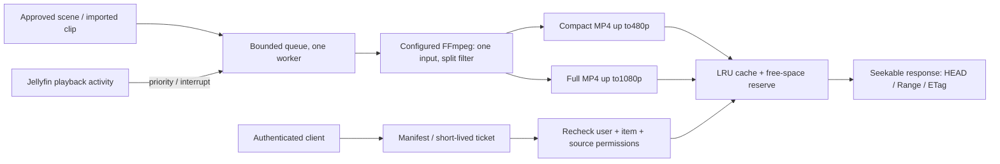

# Architecture and resource policy

## Separate the three workloads

Full playback stays in Jellyfin's playback engine: direct play when supported,
remuxing when possible and transcoding otherwise. Its HLS/session reporting,
ephemeral transcode cache and cleanup remain authoritative. Preview generation
does not create a second persistent full-film encoding or start a playback session.

Timeline thumbnails remain Jellyfin Trickplay sprites. They are cheap image tiles
for seeking, not moving scene excerpts. This plugin neither replaces nor generates
them. Existing server-side Trickplay generation and its hardware options remain
independent.

Scene previews are bounded15–25s clips (hard maximum30s), prepared once and served
many times. A plugin-held scene catalogue replaces a library-specific client registry.
Approval and timestamps are durable metadata; encoded files are disposable cache.

## Why pre-encoded MP4

A hover must not start a personal playback/transcoding session. Repeated sessions
would multiply CPU/GPU work and risk confusing playback history. HLS introduces
playlist/segment requests and extra server state for a small bounded clip. A
faststart MP4 allows the browser to begin before the whole clip arrives and use
ordinary byte ranges. Only one visible preview plays, muted initially and once per
surface/item/visit. The other encode is not fetched.

Compact output uses a CRF25 target capped at800kbit/s; full uses CRF22 capped at
3.5Mbit/s. Stereo AAC is96kbit/s. These are encoder limits, not a guaranteed file
size or visual quality. Resolution follows source aspect ratio and never upscales.
A decoded scene is split into the two encodes in one process. No complete media
copy is materialized. HDR10/HLG use an SDR tone-map filter; codec/renderer limits
must be validated on a server's actual FFmpeg build.

Default hardware policy follows Jellyfin's configured NVENC or Linux QSV encoder
and DRM render node. Other configurations use bounded CPU encoding. Hardware failure
retries CPU within the same overall job deadline. QSV uses a bounded VBR target;
its adapter shares the existing server device configuration. VAAPI/AMF-specific
pipelines can be added without changing the API/cache contract.

Compatible approved imports (8-bit H264, up to1080p/30fps and within the full bitrate
budget) reuse their full video packets without another lossy encode. Only the
compact output is resized/reencoded; compatible AAC audio is copied too. Fresh
scenes from full media still encode both outputs for accurate scene boundaries.
Frames are capped at30fps before scaling/tone mapping; source cadence is retained
below that cap. Dolby Vision profile5 is rejected until a verified tone-map path
is available; an approved SDR clip can be imported instead.

## Scheduling and lifecycle

Queue capacity64, single worker, deduplication by item and scene revision. One
replacement scene supersedes an older queued revision; an old worker cannot
publish over a new approval. New jobs wait for active playback. A job interrupted
by resumed playback is cancelled, its FFmpeg process tree is terminated and its
work files removed, then it returns to the queue. Process priority is lowered
where supported; that optional operation must not fail a completed FFprobe.
Threads are clamped1–4(default2); probe deadline30s and generation deadline5min
(default, bounded30–900s). No shell interpolation or network input protocols.

Unapproved scenes never enter the ordinary cache-serving path. A cache miss may
requeue an approved evicted clip in the background. When explicitly enabled by an
administrator, automatic mode chooses a bounded scene near 8% on first request.
This is not spoiler detection. Automatically selected scenes are marked separately
and disabled for delivery when that option is off; manual approvals are preserved.

## Cache design

Default maximum2GiB and free-space reserve2GiB, configurable. The budget includes
encoded clips, imported approved source clips and in-progress work. Imports are
limited32MiB/30s. Generated files are capped per variant. LRU eviction and idle
expiry(default30days) affect only the plugin's own cache directories. Approved
imports remain durable input and count against the same budget; a full budget can
refuse another import instead of deleting a source or silently filling a disk.

Cache identity includes source path, length, last-write timestamp, scene start and
duration, and profile schema version. Source events invalidate a ready clip whose
fingerprint changed. Metadata-only updates do not force re-encoding. Outputs are
written in private work directories and moved into the cache only after both
variants probe successfully. Catalogue writes use atomic replacement. Active file
responses hold an open stream, allowing eviction without interrupting that read.
A restart retains scene metadata and the ticket signing key; incomplete jobs are
resumed/requeued and partial outputs are never served as ready clips.

## Access and browser caching

Metadata requests use the normal authenticated Jellyfin connection. The manifest
returns short-lived signed tickets scoped to user, logical item, variant and cache
version. The video element never receives an administrator key or a full account
token. Every media request rechecks account enabled/playback policy and both logical
item and source access through Jellyfin. Permissions are not cached separately.
Ticket signatures use HMAC-SHA256 and constant-time comparison. Only fixed variants
and computed cache paths are accepted; no user-supplied filesystem path is served.

Media has a private60s browser cache policy and strong content-version ETag. Expiry
is short enough for a bounded clip; server checks still apply to every network
request. A browser may retain bytes it already received during that cache window,
just as it can retain any authorized media it has downloaded.

Client queries are scoped by server/account. Discovery is cached5min, manifests90s
with3min tickets; pending approved clips can poll every5s for at most2min while the
surface owns playback. Turning previews OFF or reduced motion ON causes no provider
requests. Missing plugin/clip errors preserve posters. Server URLs must match the
selected server's NativePreviews route; external URLs, other IDs, stream endpoints,
long videos and expired manifests are rejected.

## Existing projects considered

[Media Preview](https://github.com/spkesDE/jellyfin-media-preview-plugin) integrates
Trickplay, trailers or direct-media previews into Jellyfin Web through injection.
This client already owns its interface and needs cached scene clips independently
of that injection model. [Media Preview Generator](https://github.com/stevezau/media_preview_generator)
primarily prepares seek thumbnails, a different workload. This provider keeps the
server/client contract small and leaves their original purposes intact.

Jellyfin integration references: [plugin template](https://github.com/jellyfin/jellyfin-plugin-template),
[IMediaEncoder](https://github.com/jellyfin/jellyfin/blob/v12.0/MediaBrowser.Controller/MediaEncoding/IMediaEncoder.cs),
[validated item lookup](https://github.com/jellyfin/jellyfin/blob/v12.0/MediaBrowser.Controller/Library/ILibraryManager.cs),
[plugins documentation](https://jellyfin.org/docs/general/server/plugins/).
